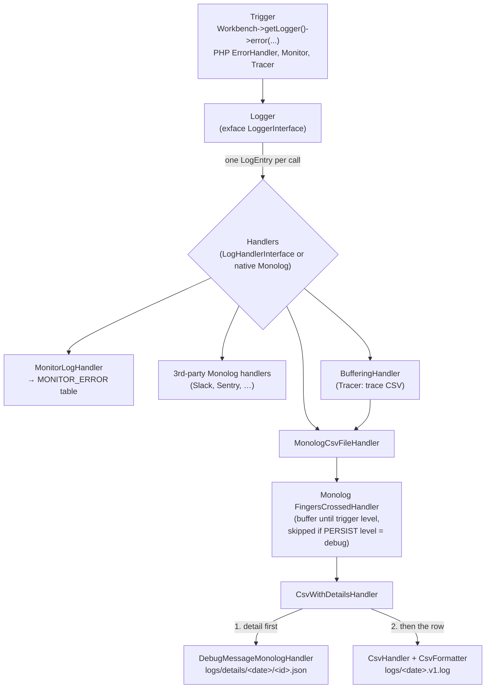
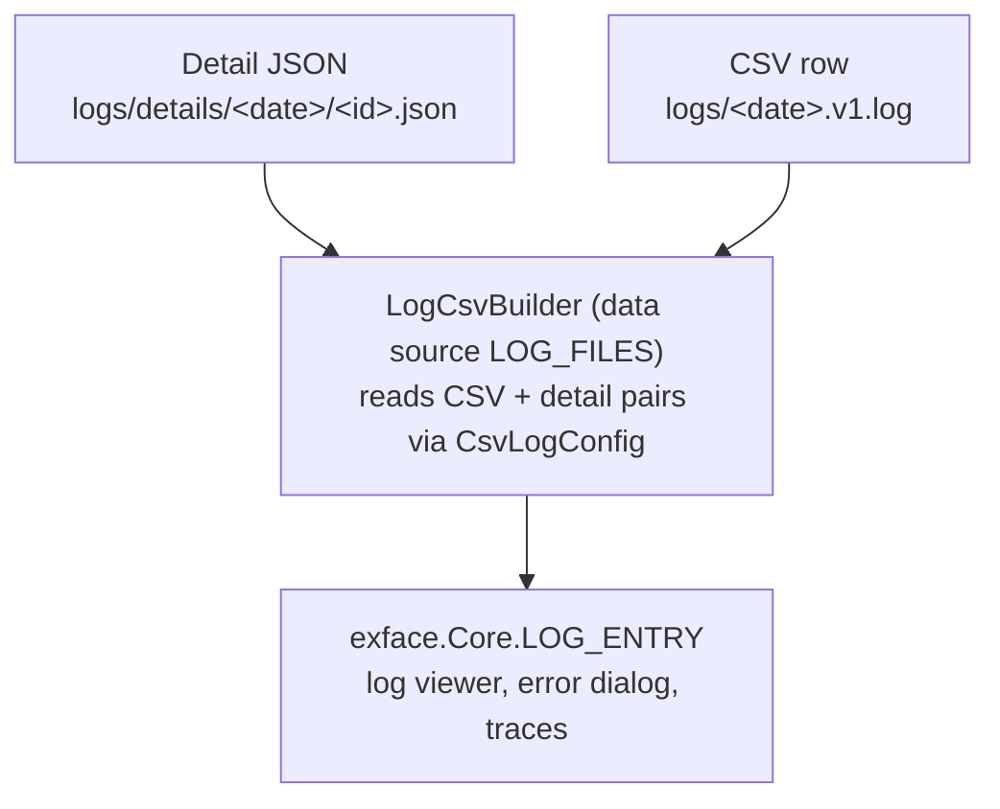

# Logging rewrite (Monolog 1 → 3): review and installation guide

This guide is for reviewers and for anyone installing the rewrite. It summarizes what was changed and why.

**In short:** the workbench logger now runs on Monolog 3. We replaced the third-party CSV writer with our own
code, made writes safe under concurrency, and added versioning to the CSV format. Old log files can still be
read. Their format is unchanged. Core and `axenox/packagemanager` **must be updated for this migration to work**
(see [Installation](#1-installation--update)).

---

## 1. Installation / update

### Prerequisites

- PHP **8.2+** (core requires `php ^8.2`. Monolog 3 alone would need 8.1).
- `exface/core` **and** `axenox/packagemanager` at versions that contain the migration. Updating only one of
  them breaks `InstallApp`. The old one does not load with the new core, and vice versa. Composer
  constraints cannot enforce this (dev branches are aliased `as 1.0`), so check it yourself.
- After step 3, `composer.lock` must list `monolog/monolog` 3.x and **no** `femtopixel/monolog-csvhandler`.

### Procedure (per installation, run from the installation root)

These steps are needed **once**, for the update to the Monolog 3 core. Afterwards the PackageManager runs its
installers in a child process, and later Composer runs work with scripts as usual.

1. **Back up** the database and the installation folder, including `logs/`.
2. Make sure a single Composer run updates **both** `exface/core` and `axenox/packagemanager`.
3. Update without scripts. Otherwise Composer may run the *old* `StaticInstaller` in-process, which fails:
   ```
   composer update --no-scripts
   ```
4. Run all installers out of process (core first, then all apps). This also clears `LastInstall.temp.json`
   and regenerates the license BOM:
   ```
   php -r "require 'vendor/autoload.php'; axenox\PackageManager\StaticInstaller::composerFinishInstall();"
   ```
   Do **not** use `composerFinishUpdate()` here. `--no-scripts` skipped the package events that fill its
   queue, so it would install nothing.
5. **Verify:**
   - `php vendor/bin/action axenox.PackageManager:InstallApp --help` lists the `apps` argument. If the
     versions do not match, the command fails to load.
   - The log viewer shows entries from both legacy (`<date>.log`) and new (`<date>.v1.log`) files, and
     filtering and sorting work.
   - The log tab in the error dialog and "Open trace" show entries.
   - New entries appear in `logs/<date>.v1.log` from the **next day** on, or immediately if no log exists
     for today yet.

### Rollback

Restore **code, Composer lock and database together**. The installer moved `LOG_ENTRY` to the
`LOG_FILES` data source, which the old core does not have. Log files written in `v1` will not be readable by
the old core.

### Configuration

No new config options.

---

## 2. Architecture: from a log call to the log viewer



**✏️ Writing (above) ↑ · 📖 Reading (below) ↓**

---



### 2.1 Trigger → Logger

- Callers only use the exface `Interfaces/Log/LoggerInterface`, which is PSR-3 plus an optional
  `iCanGenerateDebugWidgets $sender`. **No Monolog types reach the callers.** Their API did not change.
- The logger is wired up in `Factories/LoggerFactory.php` from the `LOG.*` config. That file also creates the
  PHP `error_log` fallback logger.
- Sources: any code that calls `getLogger()`, the Symfony `ErrorHandler` registered in `Debugger` (see
  [Known gaps](#6-open-items--known-gaps)), `Monitor` and `Tracer`.
- `CommonLogic/Log/Logger.php` keeps the recursion guard (errors raised while logging are queued), the
  dedup in `enqueueError()`, `generateLogId()` and the shutdown function that logs fatal errors.

### 2.2 Logger → LogEntry → handlers

- **New:** `LogEntry` (`Interfaces/Log/LogEntryInterface`) parses the PSR-3 arguments once: level, message,
  log ID, exception and sender. The exception comes from `context['exception']`, or from the sender if the
  sender is an exface exception. The log ID is the sender's own ID (`IHaveLogIdInterface`) or a generated
  one. Handlers call `getId()`, `getException()` and `getSender()` instead of reading known context keys.
  `getContext()` returns only the caller's data (without `exception`).
- The logger passes every entry to every handler. Two kinds of handlers are supported:

| Kind | Contract | Examples |
|---|---|---|
| Workbench handlers | `LogHandlerInterface::handle(LogEntryInterface $entry) : void`. Not tied to Monolog's record structure | `MonologCsvFileHandler`, `MonitorLogHandler`, `BufferingHandler`, `MonologErrorLogHandler` |
| Third-party Monolog handlers | `Monolog\Handler\HandlerInterface`, appended directly with `Logger::appendHandler()` | No current examples (Slack, Sentry, Graylog, …) |

  For third-party handlers, `Logger::createMonologRecord()` builds a standard PSR-3 `LogRecord` once per entry:
  exception in `context['exception']`, ID in `extra['id']`, channel `Workbench`. A handler only receives the
  record if its `isHandling()` returns true. Its `handle()` return value (bubbling) is ignored.
  `createMonologRecord()` is the **only** place in `Logger` that depends on Monolog's record structure.
  No adapter class is needed.
- A handler that throws is removed from the logger and the error is logged. If it was the only handler, the
  error goes to the PHP `error_log` fallback logger instead.
- **New, deduplication:** `appendHandler()` ignores an instance that is already registered (idempotent). Handlers that own
  a unique destination implement `UniqueLogHandlerInterface::getUniqueKey()`, and a second handler with the
  same key is ignored with a warning. This applies to `MonologCsvFileHandler` (class + file path),
  `MonitorLogHandler` (class) and `BufferingHandler` (key of the wrapped handler). Before this, a second
  registration logged every row twice and inserted every monitor row twice.

### 2.3 Handlers process the entry: the CSV + detail pipeline

`MonologCsvFileHandler` is the main handler. It passes the `LogEntry` through Monolog in the context key
`LogEntryInterface::MONOLOG_CONTEXT_KEY`, because the detail handler and `IdProcessor` need it. On the first
entry it lazily builds a Monolog 3 stack. If building the stack fails, it logs to PHP `error_log` instead.

1. **`FingersCrossedHandler`** buffers entries from `LOG.MINIMUM_LEVEL_TO_LOG`, flushes the buffer when
   `LOG.PERSIST_LOG_LEVEL` is reached and writes `LOG.PASSTHROUGH_LOG_LEVEL` entries right away. This
   behaviour is the same as before. If `PERSIST_LOG_LEVEL` is `debug`, this step is skipped and every entry is
   written immediately. The `Tracer` uses that mode.
2. **`CsvWithDetailsHandler`** (new, replaces Monolog 1's `GroupHandler`). It is used only if a details
   folder was passed. Both the default logger and the `Tracer` pass one. Without a details folder, the
   `CsvHandler` is used directly. It handles one record at a time, also inside a flushed batch:
   1. `DebugMessageMonologHandler` renders the details with `DebugWidgetRenderer` and writes
      `logs/details/<date>/<log-id>.json`. If that file already exists, nothing is rendered or written.
      Otherwise the file is published in three steps:
      1. The JSON is written to a temp file (`tmp*.tmp`) in the **same** details folder.
      2. The JSON is validated.
      3. `link()` creates a hard link: the final name `<log-id>.json` now points to the same data on disk as
         the temp file. The temp file name is then deleted, so only `<log-id>.json` remains.

      Why this matters:
      - **No half-written files.** The final name only appears once the content is complete. If PHP is killed
        mid-write, at most a `tmp*.tmp` file is left behind (removed by retention), never a broken
        `<log-id>.json`.
      - **No overwriting.** `link()` fails if `<log-id>.json` already exists, e.g. because another process
        wrote the same entry a moment earlier. That file is then kept as is, since it describes the same entry.
      - The temp file must be in the same folder, because hard links only work within one file system.
        The handler checks this and fails if the temp file ended up elsewhere.
      - Exception: on file systems without hard links (e.g. FAT or some network shares), `rename()` is used
        instead. It also never shows a half-written file, but it replaces an existing target. So two processes
        writing the same ID at the same moment could replace each other's file. Both files describe the same
        entry, so nothing is lost.
      - Log IDs that are not plain tokens are rejected, to prevent path traversal.
   2. **Only if step 1 succeeded**, `CsvHandler` appends the CSV row. If the detail file fails, only that row
      is skipped and the failure is reported via `error_log()`.
   - Result: no CSV row ever points to a missing detail file. A detail file without a row is acceptable and
     is removed by retention.
   - Both inner handlers must use the same level. Otherwise the constructor throws.
3. **`CsvHandler` + `CsvFormatter`** (new, replace `femtopixel/monolog-csvhandler`):
   - The formatter writes the columns explicitly, as defined in `CsvLogConfig`.
   - It sanitizes values: invalid UTF-8 becomes U+FFFD, and JSON that cannot be encoded becomes
     `[JSON encoding failed]`. Nested data is cut off at depth 9 and after 1000 items.
   - The handler rejects rows whose columns do not match the version's layout. It also parses every line back
     before writing it. In both cases it writes a fallback row instead of a broken line: message
     `[row encoding failed]`, keeping only id, requestId, level, level_name, channel and datetime. If even
     that fails, the entry is skipped and reported via `error_log()`.
   - Each line is written with a single `fwrite` under `LOCK_EX`. The lock is released even if the write throws.

**Processors** now return immutable `LogRecord`s and write into `extra` (base class
`AbstractContextProcessor`). Column order is decided by the formatter, not by the processors.

| Processor | Attached to | Runs |
|---|---|---|
| `IdProcessor`, `RequestIdProcessor`, `UserNameProcessor`, `ActionAliasProcessor` | `FingersCrossedHandler` (unbuffered: the writer) | at **log time**. Do nothing before the workbench has started, and catch all errors |
| `ContextFilterProcessor` (removes the `LogEntry` object from the CSV context) | `CsvHandler` | at **flush time**, after the detail handler has used the entry |

Other handlers:
- `MonitorLogHandler` writes to `MONITOR_ERROR`. It renders the error widget with the new standalone
  `CommonLogic/Debugger/DebugWidgetRenderer` (this replaces the removed `DebugWidgetProcessor`).
- `BufferingHandler` buffers entries and passes them to the handler it wraps on `__destruct`. The `Tracer` uses
  it around an unbuffered `MonologCsvFileHandler` that writes the trace file.
- `MonologErrorLogHandler` writes to PHP `error_log` and is the fallback when initialization or persistence fails.

### 2.4 Output: CSV + detail file pairs

`CommonLogic/Log/CsvLogConfig.php` is the **single source of truth** for the file format. The writer and the
reader both use it.

- File name: `<base>[.<version>].<ext>`. Examples: `logs/2026-11-05.v1.log` and
  `logs/traces/<time>.v1.csv`. Legacy files have no version key. The masks `logs/*.log` and
  `logs/traces/*.csv` still match.
- Details are always stored at `logs/details/<base>/<log-id>.json`, in every version.
- There is at most **one daily log per date**. If today's file already exists in an older version,
  `LoggerFactory` keeps writing to it in that version (`getVersionForWriting()`). A new format therefore starts
  on the next day. Trace files always use the current version.
- As before, the context column contains neither the exception nor the sender. Both are stored only in the
  detail file. `LogEntry` takes the exception out of the context.

| | Legacy (no key) | `v1` (current) |
|---|---|---|
| Columns | id, requestId, userName, actionAlias, message, context, level, level_name, channel, datetime, extra | **datetime, id, requestId, level, level_name, channel**, userName, actionAlias, message, context, extra |
| Enclosure / escape | `'` / `\` | `"` / none (RFC 4180, quotes doubled). Opens correctly in Excel |
| Date format | `Y-m-d H:i:s.v` | `Y-m-d H:i:s.v` |

Rules for changing the format: never edit an existing version. Append a new one and bump `CURRENT_VERSION`.
Reordering columns needs no model change. A new column also needs a new `LOG_ENTRY` attribute.

### 2.5 UI: reading via the meta model

- `exface.Core.LOG_ENTRY` now uses the **new data source `LOG_FILES`**, whose query builder is
  `QueryBuilders/LogCsvBuilder.php` (it extends `CsvBuilder`).
- `LogCsvBuilder` reads the version from the file name. It takes the columns, delimiter, enclosure and escape
  character for that version from `CsvLogConfig`. It returns `null` for columns that do not exist in the
  file's version.
- `LOG_ENTRY` attributes address columns **by name** (`datetime`, `level_name`, …) instead of index, so
  legacy and `v1` files render through the same object.
- `MONITOR_ERROR.LOG_FILE` still builds `logs/<date>.log` in SQL. `LogCsvBuilder::queryFile()` falls back to
  the file with the same base name (any version), so the log tab in the error dialog works for new files.
- A last record without a line ending (still being written) is ignored. Readers do not take locks.
- The detail JSON is loaded using the log ID from the CSV row, the same way as before.
- `TRACE_LOG` stays on `FileBuilder`. Its regexes now accept both `"X"` and `""X""`.

---

## 3. Major changes compared with the old system

| Area | Before (Monolog 1) | Now (Monolog 3) |
|---|---|---|
| Platform | `php ^8`, `monolog ^1.22`, psr/log 1, `femtopixel/monolog-csvhandler` | Monolog 3 needs PHP 8.1+, and core already requires `php ^8.2`. `monolog ^3.12`, `psr/log ^2 \|\| ^3`, **FemtoPixel removed** |
| Public interfaces (**breaking** for code outside core that implements them; none found in this installation's `vendor`) | `LogHandlerInterface::handle($level, $message, $context, $sender)` | `LogHandlerInterface::handle(LogEntryInterface $entry) : void`. `LoggerInterface` methods return `void` (PSR-3 v3). `appendHandler()`/`removeHandler()` also accept Monolog handlers. New `SecurityManagerInterface::getAuthenticatedTokenIfExists()` |
| Record model | Mutable arrays, columns positioned with `array_slice` (`AbstractColumnPositionProcessor`) | Immutable `LogRecord`. Processors write to `extra`, and the formatter sets the column order. Abstract class removed |
| Levels | Integers (`Logger::DEBUG`) | `Monolog\Level` enum. `LogLevelDataType` was ported, its public signatures are unchanged |
| Handler input | Context keys (`id`, `exception`, `sender`) | `LogEntry` object |
| Third-party handlers | Not supported directly | Appended natively with `appendHandler()` |
| Handler duplicates | Not prevented. A second registration would have written every row twice | Checked by instance and by `UniqueLogHandlerInterface` key |
| CSV writer | FemtoPixel, no locking | First-party `CsvHandler`: `LOCK_EX` per line, layout and round-trip checks, fallback row |
| Detail files | Check-then-write, could be left partial | Temp file → validate → `link()`. An existing file is left untouched (except in the `rename()` fallback, see 2.3) |
| Write order | CSV and details written independently (batch: all rows, then all details) | Detail first, then the CSV row, record by record |
| Processor timing | All processors ran at flush time | User, action and request ID are captured at **log time**. The user name is read with `getAuthenticatedTokenIfExists()` and never triggers authentication |
| File format | One format, read by column index | Versioned (`CsvLogConfig`). `v1` uses the RFC 4180 / Excel format and puts the fixed-width columns first |
| Reader | `CsvBuilder`, columns addressed by index | `LogCsvBuilder` on `LOG_FILES`, columns addressed by name, works with every version |
| `CsvBuilder` pagination | `offset` returned too many rows. With filters there was no pagination | Fixed in `CsvBuilderTrait` (affects all CSV objects) |
| Repair (`LogCleaner`) | Counted commas, which could delete valid multi-line rows | Parses with `fgetcsv()` per version, validates each record, moves broken records to `logs/quarantine/` first, works on files in use (`LOCK_EX`), streams the file (10 MB peak on a 57 MB log) |
| Cleanup | Detail folders of versioned files were missed | Uses `CsvLogConfig::getBaseName()` |
| Composer scripts | Workbench booted inside Composer, which fails with Monolog 3 (Composer bundles psr/log 1) | `StaticInstaller::runInChildProcess()` (PackageManager) runs installers in a child PHP process |
| Error widget for monitor | `MonitorLogHandler` called `DebugWidgetProcessor` with a hand-built array | `DebugWidgetRenderer`. PackageManager's `InstallApp` uses it too |
| Dead code | `LoggerFactory::registerErrorLogger()`, `Monolog/MessageOnlyFormatter` (unused, never ported to Monolog 3) | Removed |
| `TRACE_LOG` | Regexes expected `"X"` | Regexes accept both `"X"` and `""X""` |

### Suggested review order

All changes are on core branch `Migrations/Monolog` (40 files compared with `origin/1.x-dev`).

0. `composer.json`: the dependency changes (Monolog 3, psr/log, FemtoPixel removed).
1. `CommonLogic/Log/CsvLogConfig.php`: the format contract.
2. `Interfaces/Log/LoggerInterface.php`, `Interfaces/Log/LogHandlerInterface.php`,
   `Interfaces/Log/LogEntryInterface.php`, `Interfaces/Log/UniqueLogHandlerInterface.php`,
   `CommonLogic/Log/LogEntry.php`, `CommonLogic/Log/Logger.php` (`appendHandler`, `createMonologRecord`).
3. `Factories/LoggerFactory.php` → `Handlers/MonologCsvFileHandler.php` → `Handlers/CsvWithDetailsHandler.php`.
4. `Handlers/CsvHandler.php`, `Monolog/CsvFormatter.php`, `Monolog/DebugMessageMonologHandler.php`.
5. `Processors/*`, `Handlers/MonitorLogHandler.php`, `Handlers/BufferingHandler.php`,
   `Handlers/MonologErrorLogHandler.php`, `CommonLogic/Debugger/DebugWidgetRenderer.php`,
   `DataTypes/LogLevelDataType.php`, `CommonLogic/Tracer.php`, `Security/SecurityManager.php` and its
   interface.
6. Read side: `QueryBuilders/LogCsvBuilder.php`, `QueryBuilders/CsvBuilder.php`, `Traits/CsvBuilderTrait.php`,
   `Model/05_DATASRC.json`, `Model/exface.Core.LOG_ENTRY/02_OBJECT.json` + `04_ATTRIBUTE.json`,
   `Model/exface.Core.TRACE_LOG/04_ATTRIBUTE.json`.
7. `CommonLogic/Log/LogCleaner.php`.
8. `axenox/packagemanager` (branch `MonologMigration`): `StaticInstaller::runInChildProcess()` and `InstallApp`
   (commit `7e38a60`).

---

## 4. How to extend the new eco-system

- **A third-party Monolog handler:** call `$logger->appendHandler(new SlackWebhookHandler(...))`. Do not
  add it inside `MonologCsvFileHandler`'s internal stack. The `handle()` return value (bubbling) is ignored.
- **A workbench handler with its own destination:** implement `LogHandlerInterface`. Also implement
  `UniqueLogHandlerInterface` if two instances must not write to the same destination.
- **A new CSV format:** append a version to `CsvLogConfig::VERSIONS` (key with a letter, no dots), bump
  `CURRENT_VERSION`, and keep the `.log` / `.csv` extension.

---

## 5. Open items / known gaps

- **Not verified on Linux:** in-place repair with writers holding `'a'` handles, and `LogCsvBuilder`'s check
  for an incomplete last record.
- Full `composer update` **with scripts** in `exface-m3` (only `run-script post-update-cmd` was verified).
- Release preparation in the root `composer.json` of the installation:
  - Set `exface/core` back to `dev-1.x-dev as 1.0` and remove the `hail-cookies/Core` VCS repository.
  - Do the same for `axenox/packagemanager`: it currently uses `dev-MonologMigration as 1.0` from the
    `hail-cookies/PackageManager.git` repository.
  - Run `composer update` and confirm that no harness files were committed.
  - Release PackageManager **together with** the core.
- `MonologErrorLogHandler` could be replaced by a native Monolog `ErrorLogHandler` appended directly (TODO in the class).
- Optional: cache the user name and action alias per request, write a flushed batch under a single lock,
  add a checksum column (would require a new format version).
- Limitations:
  - When introducing a new log version, a process started before the deploy keeps writing its legacy file for that day.
  - Detail files are not guarded by `fsync`, so they may be lost on power failure (by decision).
  - Each killed write leaves one `tmp*.tmp` file in the details folder. Retention removes it.