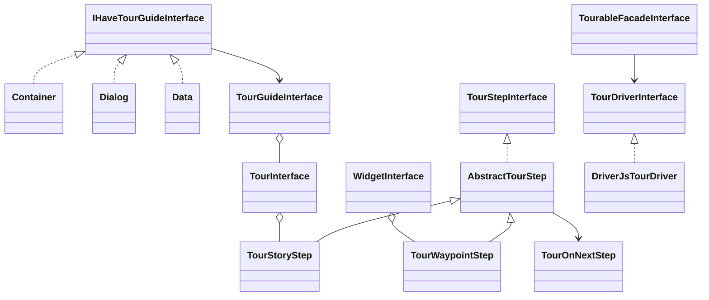

# Tours (UI tours)

Tours guide users step by step through a page or dialog: a popover with a title and text appears next to a highlighted widget. Tours are configured entirely in UXON.

- [Overview](#overview)
- [Quick start](#quick-start)
- [Tour guide (`tour_guide`)](#tour-guide-tour_guide)
- [Tour (`tours`)](#tour-tours)
- [Steps](#steps)
- [Action on "Next" (`on_next_step`)](#action-on-next-on_next_step)
- [Starting tours automatically](#starting-tours-automatically)
- [Architecture for developers](#architecture-for-developers)

## Overview

There are two ways to define steps:

| Type | Defined via | Order | Usage |
|------|-------------|-------|-------|
| **Story steps** (`TourStoryStep`) | Property `steps` directly in the tour | Order in the UXON (top to bottom) | Recommended for tours with a fixed order |
| **Waypoint steps** (`TourWaypointStep`) | Property `tour_steps` on any widget | Via `waypoints_route` and optionally `position_in_tour` | Unordered tours; one step can belong to multiple tours |

If a tour contains `steps`, waypoint steps are **not** included automatically (the waypoint route is empty in this case).

## Quick start

```json
{
    "widget_type": "DataTable",
    "object_alias": "my.App.ORDER",
    "tour_guide": {
        "tours": [
            {
                "title": "Orders",
                "steps": [
                    {
                        "title": "Filter",
                        "body": "Narrow down the list here.",
                        "widget_to_focus": "my_filter_id",
                        "side": "bottom",
                        "align": "start"
                    },
                    {
                        "title": "Final note",
                        "body": "Without widget_to_focus the popover is shown in the center."
                    }
                ]
            }
        ]
    }
}
```

As soon as at least one tour is defined, a dropdown menu (icon "travel-request") listing all tours appears in the top toolbar.

## Tour guide (`tour_guide`)

The tour guide is a collection of tours (`\exface\Core\Widgets\Parts\Tours\TourGuide`). It can be defined on

- `Container` (including dashboards and the page root)
- `Data` widgets (tables, etc.)
- `Dialog`

If `tour_guide` is defined on a widget that is located **inside** a dialog, its tours are passed on to the surrounding dialog (or to the page root if there is no dialog). If the widget is a dialog itself, the tours stay there.

```json
"tour_guide": {
    "tours": [
        {"title": "", "waypoints_route": "~all"}
    ]
}
```

## Tour (`tours`)

| Property | Type | Default | Description |
|----------|------|---------|-------------|
| `title` | string (translatable, required) | - | Title in the tour menu |
| `description` | string (translatable) | - | Description. Currently not shown in the UI because the dropdown cannot display descriptions |
| `id` | string | - | Tour id. Required to start the tour via `on_next_step.autostart_tour_id` or a URL parameter |
| `icon` | string | - | Icon in the tour menu |
| `steps` | story steps[] | - | Ordered steps (see below) |
| `waypoints_route` | string | `~all` | Which waypoints the tour visits |
| `show_progress` | boolean | `true` | Shows the current step number and total in the popover |
| `disable_active_interaction` | boolean | `false` | Prevents clicks on the highlighted element while the tour is active. The tour can still be closed by clicking outside |
| `autorun` | boolean | `false` | Starts the tour automatically when the view is loaded |
| `hide_in_menu` | boolean | `false` | Hides the tour from manual selection. Automatic continuations, URL starts and `autorun` are unaffected |

### Waypoint route

The route consists of one or more waypoints joined by `&`:

- `news` - only steps with the waypoint `news`
- `~all` - all steps
- `news&intro` - steps with either the waypoint `news` or `intro`

Steps are first grouped by the order of the waypoints in the route (for `~all` alphabetically by waypoint combination) and then sorted by `position_in_tour`. Steps without a position follow at the end of their group in UXON order. Story steps are always appended **after** the waypoint steps.

## Steps

Both step types share these properties (`AbstractTourStep`):

| Property | Type | Default | Description |
|----------|------|---------|-------------|
| `title` | string (translatable, required) | - | Title of the popover |
| `body` | string | empty | Detailed text |
| `side` | `top`, `right`, `bottom`, `left` | `bottom` | Side of the popover relative to the highlighted element |
| `align` | `start`, `center`, `end` | `start` | Alignment of the popover relative to the element |
| `focus_css_query` | string | - | CSS query within the target widget. Highlights the first match; without a match, highlights the widget itself |
| `on_next_step` | object | - | Action when the user clicks "Next" |

Invalid values for `side` and `align` cause an error.

### Focusing part of a widget with CSS

Use `focus_css_query` to highlight a specific descendant of `widget_to_focus`:

```json
{
    "title": "Filters",
    "widget_to_focus": "GanttTerminuebersicht",
    "focus_css_query": ".sapFDynamicPageHeader"
}
```

In the UI5 facade, `.sapFDynamicPageHeader` targets the filter header and `.sapFDynamicPageContent` targets the main content area.

The query is evaluated when the step is displayed, inside the widget's DOM element:

- If multiple elements match, the first in DOM order is used.
- If no element matches, the complete target widget is highlighted instead.
- An omitted, empty or whitespace-only query keeps whole-widget highlighting.
- Invalid CSS syntax causes a browser error rather than triggering the no-match fallback.

The query does not search the whole document. A story step without `widget_to_focus` remains a centered popover, even if a query is configured. For waypoint steps, the query is relative to the step's own widget (or its input for filters).

Selectors depend on the facade's HTML structure. Hidden or virtualized rows must already be visible and rendered to be highlighted; a CSS query does not load data, expand headers or scroll to an unrendered row. `on_next_step` still calls a function on the linked widget, not on the element found by CSS.

### Story steps (`steps` in the tour)

Additional property: `widget_to_focus` - a widget link to the widget to highlight. If omitted, the popover is shown in the center without highlighting.

```json
"steps": [
    {
        "widget_to_focus": "my-widget-id",
        "title": "New column",
        "body": "This text appears in the popover.",
        "side": "bottom",
        "align": "center"
    }
]
```

### Waypoint steps (`tour_steps` on a widget)

Every widget can have `tour_steps`. The **widget itself** is highlighted (for a `Filter` its input widget).

| Property | Type | Description |
|----------|------|-------------|
| `waypoints` | string[] | Waypoints (tour identifiers) this step belongs to. One step can belong to multiple tours |
| `position_in_tour` | int | Position within the tour. **Will be deprecated** - use `steps` for ordered tours |

```json
"tour_steps": [
    {
        "waypoints": ["news", "table"],
        "position_in_tour": 1,
        "title": "New column",
        "body": "This text appears in the popover.",
        "side": "bottom",
        "align": "center"
    }
]
```

## Action on "Next" (`on_next_step`)

Rename `on_next_step_function` to `on_next_step` in existing tour configurations; the old property name is no longer supported.
Inside `on_next_step`, rename `function` to `widget_function` as well.

| Property | Description |
|----------|-------------|
| `widget_function` | Name of the widget function to call on the highlighted widget (e.g. `press`). An argument list in parentheses is stripped |
| `browser_click` | `left_click`, `right_click` or `double_click`. Fires that mouse event on the highlighted DOM element instead of calling a widget function. Wins over `widget_function` if both are set |
| `autostart_tour_id` | Id of a tour to start automatically once the corresponding view is loaded |
| `skip_if_standalone` | Boolean, default `false`. Skips this step's entire action (`widget_function` and `autostart_tour_id`) when the tour is started from its menu |

### Example: clicking a CSS-targeted element

`widget_function` needs a widget. A step that highlights a part of a widget via `focus_css_query` has only a DOM element, so use `browser_click`:

```json
"focus_css_query": ".myToolbarButton",
"on_next_step": {
    "browser_click": "left_click"
}
```

### Example: continuing a tour inside a dialog

1. The last step of the first tour highlights a button that opens the dialog and has `"widget_function": "press"`.
2. The dialog defines a `tour_guide` with a tour that has an `id` (e.g. `"dialog_tour"`).
3. The step from 1. gets `"autostart_tour_id": "dialog_tour"`.

```json
"on_next_step": {
    "widget_function": "press",
    "autostart_tour_id": "dialog_tour"
}
```

When the user clicks "Next", the dialog opens and the dialog tour starts automatically. The pending tour intent expires after 60 seconds.

Steps with `autostart_tour_id` keep the translated "Next" button label even at the end of a tour, because the walkthrough continues with another tour. Without a continuation, the last step uses the translated "Done" label.

### Offering a partial tour separately

Set `"skip_if_standalone": true` inside a step's `on_next_step` to skip that action when the user starts the tour from its menu. This lets a partial tour stand on its own while keeping its continuation in a longer walkthrough:

```json
{
    "title": "Recalculate progress history",
    "id": "progress_history",
    "steps": [
        {
            "title": "Close",
            "widget_to_focus": "Dialog_Schliessen",
            "on_next_step": {
                "skip_if_standalone": true,
                "widget_function": "press",
                "autostart_tour_id": "sections"
            }
        }
    ]
}
```

Starting this tour from its menu ends at "Done": neither the close button nor the `sections` tour is triggered, so the dialog stays open. If another tour starts `progress_history` via `autostart_tour_id`, its final button says "Next", closes the dialog and continues to `sections`. No duplicate steps are needed.

The flag applies to the whole action, regardless of the widget function, step position or presence of `autostart_tour_id`. The step itself remains visible; only its action is skipped. Unmarked actions in the same tour still execute, including their follow-up tours. On the final step, a skipped continuation uses "Done" rather than "Next".

The default is `false`, preserving existing behavior. URL starts and `autorun` continue to follow `autostart_tour_id`. A new menu start discards any pending continuation from a previous walkthrough; its mode does not affect later runs.

The former tour-level property `standalone_on_manual_start` is no longer supported. Remove it and add `skip_if_standalone` to each `on_next_step` action that should be skipped during a menu start.

### Hiding a tour from the menu

Set `"hide_in_menu": true` on a tour to hide its entry from manual selection, for example when it is only intended as a continuation of another tour:

```json
{
    "title": "Dialog details",
    "id": "dialog_tour",
    "hide_in_menu": true,
    "steps": [
        {
            "title": "Dialog",
            "body": "This part of the walkthrough explains the dialog."
        }
    ]
}
```

The tour remains available through `autostart_tour_id`, its URL parameter and `autorun`. The default is `false`, so existing tours remain visible. If all tours on a widget are hidden, no tour menu button is shown; automatic starts still work.

## Starting tours automatically

- `autorun: true` on the tour - starts when the view is shown.
- URL parameter `?tour=<tour-id>` - starts the tour with that `id`. The parameter is removed from the URL afterwards, so back/forward navigation does not retrigger the tour.
- `autostart_tour_id` (see above) - starts after a step of another tour.

## Architecture for developers



### Data side (Core)

| Class / interface | Responsibility |
|-------------------|----------------|
| `Interfaces\Widgets\IHaveTourGuideInterface` + `Widgets\Traits\IHaveTourGuideTrait` | Widgets with `tour_guide` (`getTourGuide()`, `hasTourGuide()`, `setTourGuide()`). Passes tours on to the dialog or page root |
| `Interfaces\Tours\TourGuideInterface`, `Widgets\Parts\Tours\TourGuide` | Collection of tours (`getTours()`, `addTour()`); has a caption |
| `Interfaces\Tours\TourInterface`, `Widgets\Parts\Tours\Tour` | Tour definition. `getSteps($driver)` delegates to the driver because only the driver combines the definition with the steps |
| `Interfaces\Tours\TourStepInterface`, `AbstractTourStep` | Common step properties (title, body, side, align, next-step function) |
| `TourStoryStep` | Ordered step with `widget_to_focus` (widget link) |
| `TourWaypointStep` | Step defined on a widget (`WidgetInterface::getTourSteps()`, property `tour_steps` in `AbstractWidget`) with `waypoints` |
| `TourOnNextStep` | Configuration of `widget_function` and `autostart_tour_id` |

### Rendering side (facades)

| Class / interface | Responsibility |
|-------------------|----------------|
| `Interfaces\Facades\TourableFacadeInterface` | Facades supporting tours return a driver via `getTourDriver($widget)` |
| `Interfaces\Tours\TourDriverInterface` | Generates JS for tours; collects waypoint steps (`registerWaypointStep()`) and returns the steps of a tour (`getTourSteps()`). The driver library is included in the facade-specific TourGuideTrait |
| `Facades\AbstractAjaxFacade\Tours\DriverJsTourDriver` | Implementation based on [driver.js](https://driverjs.com). Filters/sorts steps, builds `buildJsStartTour()`, resolves the highlighted DOM element through the facade's `buildJsDomElementGetter()` and builds `onNextClick`. Without a focus widget the popover is centered |
| `UI5Facade\...\Traits\UI5TourGuideTrait` | Builds the tour dropdown (`buildJsTourGuideDropdown()`), registers driver.js as external module, sets up autostart via `onShowView` and provides `window.exfTourContext` (`buildJsWindowTourContent()`) |

### Flow in the UI5 facade

1. `UI5AbstractElement` registers the `tour_steps` of every widget as waypoint steps at the driver when the element is created.
2. `UI5Container`, `UI5Dashboard`, `UI5Dialog` and `UI5DataElementTrait` add the menu to their toolbars via `buildJsTourGuideDropdown()`. This shared integration initializes `window.exfTourContext` when the controller is initialized, including pages without data widgets.
3. Clicking a menu item makes the driver generate the JS (`driver.js.driver({...}).drive()`).
4. With `autostart_tour_id` the driver calls `window.exfTourContext.setPendingTour()` before invoking the widget function, so even a synchronously opened dialog can find the intent. The target view consumes the intent via `consumePendingTour()` and starts the tour after 500 ms.

Closing a popup dialog also notifies visible tour hosts to check for a pending tour. This allows a dialog's last step to close the dialog and continue with a tour on the underlying page. This check does not repeat the page's view lifecycle, reload data, process URL triggers or restart unconditional `autorun` tours. Listeners are removed when their view is destroyed; hidden or closed tour hosts do not consume pending intents.

DOM targets are resolved when each step is displayed. For UI5 data widgets, the DOM getter returns the outer dynamic-page wrapper (including filters), otherwise the panel wrapper, or the control itself if neither wrapper exists. Explicit links to individual column or filter widgets still target those elements. Column and row references within a widget link are not yet used to select tour targets.

When `focus_css_query` is configured, the tour driver applies `querySelector()` to this DOM target and uses the first match, falling back to the target itself if the query returns no match. Facade DOM getters do not need to implement CSS targeting separately.

To support another tour library, implement a new `TourDriverInterface` and add it to `registerDriverLibAsExternalModule()` of the respective facade trait.

### Known limitations

- The tour `description` is currently not displayed.
- `position_in_tour` will be removed in the future.
- `on_next_step` on steps whose widget lives in another view may fail because of a missing controller; the error is currently caught and logged via `console.warn`.
